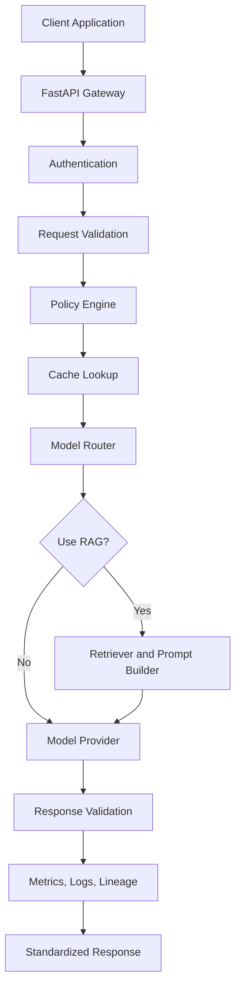
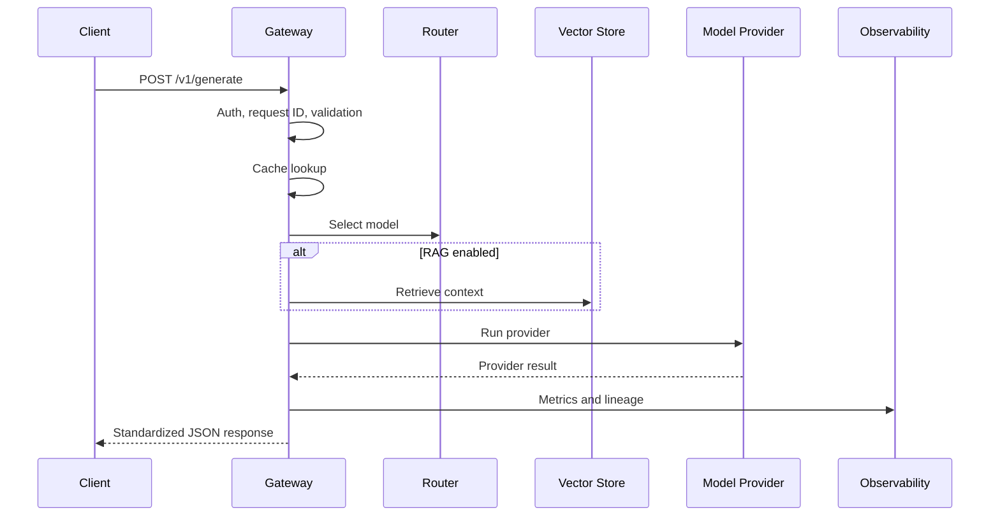
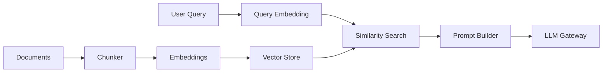

# LLM Gateway & Foundation Model Hosting Platform


I built this university project as a production-style LLM Gateway for routing requests across local and future remote foundation model providers.

The project demonstrates LLM infrastructure, backend engineering, MLOps design, model routing, retrieval augmented generation, caching, observability, reliability patterns, model governance, containerization, Kubernetes deployment design, and cloud architecture planning.

## Table of Contents

- [Project Overview](#project-overview)
- [Why I Built This](#why-i-built-this)
- [Key Features](#key-features)
- [Architecture](#architecture)
- [Technology Stack](#technology-stack)
- [Project Structure](#project-structure)
- [Quick Start](#quick-start)
- [Live Dashboard](#live-dashboard)
- [API Examples](#api-examples)
- [Routing Strategies](#routing-strategies)
- [RAG Pipeline](#rag-pipeline)
- [Observability](#observability)
- [Security](#security)
- [Database and Migrations](#database-and-migrations)
- [Docker and Deployment](#docker-and-deployment)
- [Testing](#testing)
- [Load Testing](#load-testing)
- [Documentation](#documentation)
- [What Is Real vs Local Demonstration](#what-is-real-vs-local-demonstration)
- [Limitations](#limitations)
- [Future Improvements](#future-improvements)

## Project Overview

Modern applications often need to access multiple language models, embedding models, and retrieval systems. Calling each model directly from every application creates duplicated logic for authentication, validation, routing, retries, caching, monitoring, and governance.

This project solves that by placing a centralized gateway between client applications and model providers.

High-level flow:

```text
Client
-> FastAPI Gateway
-> Authentication and validation
-> Policy checks
-> Cache lookup
-> Dynamic model routing
-> Optional RAG retrieval
-> Model provider execution
-> Response validation
-> Metrics, logging, and lineage
-> Standardized response
```

## Why I Built This

I wanted the project to show more than a simple chatbot API. The goal was to build a realistic infrastructure-style system that I can explain in a university project review:

- How model gateways work.
- Why model providers should be abstracted.
- How routing decisions can balance cost, quality, latency, and throughput.
- How RAG fits into a gateway architecture.
- How caching, retries, and circuit breakers improve reliability.
- How platform teams monitor model usage and request behavior.
- How the same system could be deployed with Docker, Kubernetes, Helm, and AWS.

## Key Features

- FastAPI backend with versioned `/v1` endpoints.
- Browser dashboard for project presentation and live demos.
- Standard request and response schemas using Pydantic.
- API-key authentication.
- In-memory rate limiting for local development.
- Request ID middleware.
- YAML-backed model registry.
- Dynamic model routing strategies.
- Provider abstraction with local deterministic provider and optional Hugging Face provider.
- Async inference engine.
- Stable request cache keys and local cache backend.
- Token accounting and estimated cost calculation.
- Retry and circuit-breaker primitives.
- RAG pipeline with chunking, embeddings, vector search, prompt augmentation, and returned sources.
- Prometheus metrics at `/metrics`.
- Structured logging setup.
- SQLAlchemy metadata models.
- Alembic initial migration.
- Dockerfile and Docker Compose.
- Kubernetes manifests.
- Helm chart.
- Terraform AWS foundation.
- GitHub Actions CI workflow.
- Unit and integration tests.

## Architecture



Request sequence:



Full architecture details are in [docs/architecture.md](docs/architecture.md).

## Technology Stack

| Area | Tools |
| --- | --- |
| Backend API | Python, FastAPI, Pydantic |
| Model serving | Provider abstraction, optional Hugging Face Transformers |
| Local inference demo | Deterministic local provider |
| RAG | Chunking, embeddings abstraction, in-memory vector search |
| Cache | In-memory cache, Redis backend abstraction |
| Database | SQLAlchemy, Alembic, SQLite local option, PostgreSQL deployment option |
| Observability | Prometheus metrics, structured logging |
| Reliability | Retries, fallback design, circuit breaker primitive |
| Infrastructure | Docker, Docker Compose, Kubernetes, Helm |
| Cloud design | AWS EKS, ECR, RDS, ElastiCache, S3, IAM documented in architecture |
| Testing | Pytest, FastAPI TestClient, Ruff |
| CI/CD | GitHub Actions |

## Project Structure

```text
.
├── app/
│   ├── api/                 # FastAPI routes, dependencies, middleware
│   ├── cache/               # Cache interfaces and implementations
│   ├── core/                # Settings, security, logging, exceptions
│   ├── db/                  # SQLAlchemy models and sessions
│   ├── gateway/             # Model registry and router
│   ├── governance/          # Policy, lineage, responsible-use hooks
│   ├── inference/           # Engine, batching, reliability, resource monitor
│   ├── observability/       # Prometheus metrics
│   ├── providers/           # Provider interface, local and Hugging Face providers
│   ├── rag/                 # Chunker, retriever, vector store, RAG pipeline
│   ├── schemas/             # Pydantic request and response schemas
│   └── main.py              # FastAPI app and browser dashboard
├── configs/                 # Model, routing, and policy YAML files
├── docs/                    # Architecture and project documentation
├── infra/                   # Kubernetes, Helm, and Terraform
├── monitoring/              # Prometheus configuration
├── scripts/                 # Ingestion, benchmark, seed scripts
├── tests/                   # Unit and integration tests
├── docker-compose.yml
├── Dockerfile
├── Makefile
├── pyproject.toml
└── requirements.txt
```

## Quick Start

### 1. Clone the repository

```bash
git clone https://github.com/maheshchilukamari/LLM-Gateway-Foundation-Model-Hosting-Platform.git
cd LLM-Gateway-Foundation-Model-Hosting-Platform
```

### 2. Create a virtual environment

Windows PowerShell:

```powershell
python -m venv .venv
.\.venv\Scripts\activate
```

macOS/Linux:

```bash
python -m venv .venv
source .venv/bin/activate
```

### 3. Install dependencies

```bash
python -m pip install -r requirements.txt
```

### 4. Create local environment file

```bash
cp .env.example .env
```

On Windows PowerShell:

```powershell
copy .env.example .env
```

For the local demo, set these values in `.env`:

```env
LLM_GATEWAY_API_KEY=dev-api-key
ADMIN_API_KEY=dev-admin-key
PREFER_MOCK_PROVIDER=true
```

### 5. Run the server

```bash
uvicorn app.main:app --reload
```

Open:

```text
http://127.0.0.1:8000/
```

## Live Dashboard

The root page provides a browser-based project dashboard:

```text
http://127.0.0.1:8000/
```

It includes:

- Gateway status.
- Registered model count.
- Live generation demo.
- Live RAG demo.
- Routing strategy selector.
- Model registry cards.
- Links to API docs, model registry, metrics, and readiness checks.

Interactive API documentation:

```text
http://127.0.0.1:8000/docs
```

## API Examples

### Health

```bash
curl http://localhost:8000/health
```

### Readiness

```bash
curl http://localhost:8000/ready
```

### List Models

```bash
curl http://localhost:8000/v1/models
```

### Text Generation

```bash
curl -X POST http://localhost:8000/v1/generate \
  -H "Content-Type: application/json" \
  -H "X-API-Key: dev-api-key" \
  -d '{
    "model": "auto",
    "prompt": "Explain vector databases.",
    "routing_strategy": "balanced",
    "max_tokens": 220
  }'
```

### Chat Completions

```bash
curl -X POST http://localhost:8000/v1/chat/completions \
  -H "Content-Type: application/json" \
  -H "X-API-Key: dev-api-key" \
  -d '{
    "model": "auto",
    "messages": [
      {"role": "user", "content": "What problem does an LLM Gateway solve?"}
    ],
    "routing_strategy": "balanced"
  }'
```

### Embeddings

```bash
curl -X POST http://localhost:8000/v1/embeddings \
  -H "Content-Type: application/json" \
  -H "X-API-Key: dev-api-key" \
  -d '{
    "model": "auto",
    "input": "vector databases store embeddings"
  }'
```

### RAG Query

```bash
curl -X POST http://localhost:8000/v1/rag/query \
  -H "Content-Type: application/json" \
  -H "X-API-Key: dev-api-key" \
  -d '{
    "model": "auto",
    "query": "How do vector databases help RAG?",
    "top_k": 2,
    "similarity_threshold": 0.0
  }'
```

### Admin Model Health

```bash
curl http://localhost:8000/v1/admin/models/health \
  -H "X-API-Key: dev-admin-key"
```

## Routing Strategies

The router supports:

- `lowest_latency`
- `lowest_cost`
- `highest_quality`
- `highest_throughput`
- `balanced`
- `resource_aware`
- `fallback`

The `balanced` strategy uses weights from [configs/routing.yaml](configs/routing.yaml):

```text
score =
  quality_weight * normalized_quality
  + latency_weight * normalized_latency
  + cost_weight * normalized_cost
  + throughput_weight * normalized_throughput
```

Routing considers:

- Model availability.
- Health status.
- Capability support.
- Context window.
- Estimated cost.
- Average latency.
- Throughput score.
- Resource usage snapshot.

More details are in [docs/routing.md](docs/routing.md).

## RAG Pipeline

The RAG pipeline demonstrates:

1. Document ingestion.
2. Text chunking.
3. Embedding generation.
4. Vector storage.
5. Similarity search.
6. Prompt augmentation.
7. Gateway-based generation.
8. Returned source chunks.



The default local mode uses deterministic local embeddings so the demo works without downloading model weights. The provider abstraction allows Hugging Face embedding models to be used later.

More details are in [docs/rag.md](docs/rag.md).

## Observability

Prometheus metrics are exposed at:

```text
http://localhost:8000/metrics
```

Implemented metric families include:

- `llm_requests_total`
- `llm_request_latency_seconds`
- `llm_inference_latency_seconds`
- `llm_cache_hits_total`
- `llm_cache_misses_total`
- `llm_tokens_generated_total`
- `llm_prompt_tokens_total`
- `llm_model_requests_total`
- `llm_routing_decisions_total`
- `llm_fallback_total`
- `llm_active_requests`
- `llm_model_health`
- `llm_estimated_cost_total`

The project avoids high-cardinality metric labels such as prompt text or user IDs.

## Security

Implemented security-related features:

- API-key authentication.
- Separate admin API key.
- Environment-based secrets.
- Request schema validation.
- Request size and policy checks.
- In-memory rate limiting for local development.
- CORS configuration.
- Prompt logging disabled by default.
- `.env` excluded from Git.
- Dockerfile uses non-root user.

Example `.env` values are in [.env.example](.env.example). Real secrets should never be committed.

## Database and Migrations

The project includes SQLAlchemy models for:

- API keys.
- Models.
- Model versions.
- Request logs.
- Routing decisions.
- Model health.
- RAG documents.

Run migrations:

```bash
alembic upgrade head
```

For local development, SQLite is supported. Docker Compose is configured for PostgreSQL.

## Docker and Deployment

### Docker Compose

```bash
docker compose up --build
```

Services:

- `gateway`
- `redis`
- `postgres`
- `prometheus`
- `grafana`

### Kubernetes

Kubernetes manifests are in [infra/kubernetes](infra/kubernetes).

They include:

- Namespace.
- ConfigMap.
- Secret example.
- Gateway deployment and service.
- Redis deployment and service.
- Service account.
- HPA.
- Ingress example.

### Helm

Helm chart:

```text
infra/helm/llm-gateway/
```

Install example:

```bash
helm install llm-gateway infra/helm/llm-gateway
```

### Terraform

Terraform foundation:

```text
infra/terraform/
```

It includes scoped AWS resources and documents where production EKS, RDS, ElastiCache, IAM, and GPU node groups would be added.

More details are in [docs/deployment.md](docs/deployment.md) and [docs/aws-architecture.md](docs/aws-architecture.md).

## Testing

Run all tests:

```bash
pytest
```

Run lint:

```bash
ruff check .
```

Current local verification:

```text
18 passed
ruff check passed
alembic upgrade head passed
docker compose config passed
```

Test coverage includes:

- API contracts.
- Authentication behavior.
- Model registry loading.
- Routing strategy behavior.
- Cache key behavior.
- Memory cache round trip.
- RAG response sources.
- Embeddings endpoint.

## Load Testing

Locust file:

```text
locustfile.py
```

Run:

```bash
locust -f locustfile.py --host http://localhost:8000
```

Benchmark helper:

```bash
python scripts/benchmark.py
```

I do not claim latency, throughput, cost savings, or availability numbers unless actual results are generated and saved under `benchmarks/`.

## Documentation

Important docs:

- [Architecture](docs/architecture.md)
- [Routing](docs/routing.md)
- [RAG](docs/rag.md)
- [Reliability](docs/reliability.md)
- [SLOs](docs/slo.md)
- [Model Governance](docs/model-governance.md)
- [Responsible Model Use](docs/responsible-ai.md)
- [Accelerator Strategy](docs/accelerator-strategy.md)
- [AWS Architecture](docs/aws-architecture.md)
- [Deployment](docs/deployment.md)
- [Testing](docs/testing.md)
- [Presentation Guide](docs/presentation-guide.md)
- [Demo Guide](docs/demo.md)

## What Is Real vs Local Demonstration

Implemented and runnable locally:

- FastAPI gateway.
- API-key authentication.
- Model registry.
- Routing strategies.
- Local provider execution.
- Generation, chat, embeddings, and RAG endpoints.
- Cache behavior.
- Token and cost estimates.
- Prometheus metrics.
- SQLAlchemy models and Alembic migration.
- Tests.
- Browser dashboard.
- Docker/Kubernetes/Helm/Terraform scaffolding.

Designed as extension points:

- Full production distributed model serving.
- GPU-backed model workers.
- Real external provider pricing integration.
- Enterprise policy workflow.
- Persistent vector database deployment.
- Production-grade load testing results.

## Limitations

- The default local provider is deterministic and intended for reliable demonstration, not model-quality evaluation.
- Hugging Face execution is optional because downloading models can be slow and hardware-dependent.
- The in-memory vector store is suitable for local demos, not large-scale retrieval.
- Benchmark numbers are not included because they must be measured on the target machine.
- Terraform is intentionally scoped to avoid accidentally provisioning expensive cloud resources.

## Future Improvements

- Add a React or Streamlit frontend for richer project visualization.
- Add persistent FAISS or Chroma vector storage.
- Add Redis-backed distributed rate limiting.
- Add OpenTelemetry trace export.
- Add a real Hugging Face demo profile with downloaded small models.
- Add Grafana dashboards under `monitoring/grafana`.
- Add benchmark result export under `benchmarks/`.
- Add a deployment workflow for ECR and EKS.
- Add screenshots or a short demo video for the university submission.

## Author

Mahesh Chilukamari

