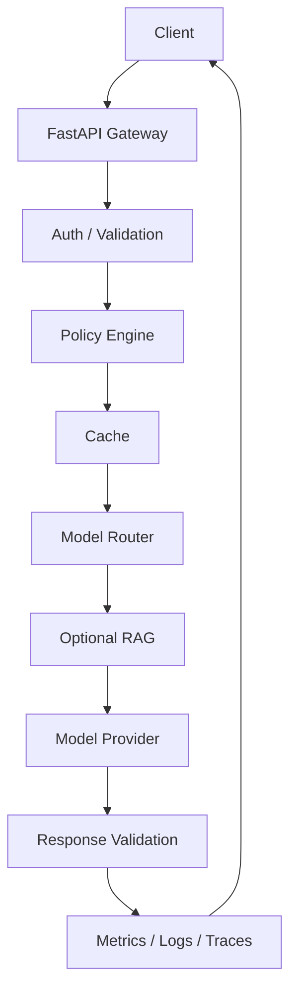

# LLM Gateway & Foundation Model Hosting Platform


I built this university project as a production-style LLM Gateway for routing requests across local and future remote foundation model providers.

The system demonstrates LLM infrastructure, MLOps, backend architecture, observability, reliability, model governance, and deployment design without requiring expensive hardware for local development.

## Problem Statement

Applications should not each implement their own model auth, request validation, provider adapters, routing logic, caching, RAG, retries, tracing, and governance. I built this gateway to expose one standardized API and centralize those platform concerns.

## Implemented Capabilities

- FastAPI application factory.
- Versioned `/v1` API contracts.
- Pydantic request and response schemas.
- API-key authentication.
- In-memory rate limiting.
- Request ID middleware.
- Health and readiness endpoints.
- YAML-backed model metadata.
- Model discovery API.
- Admin status API.
- Dynamic routing strategies.
- Provider abstraction with deterministic local provider and optional Hugging Face provider.
- Async inference engine.
- Request caching with stable cache keys.
- Token accounting and estimated cost calculation.
- Circuit breaker and retry primitives.
- Local RAG pipeline with chunking, deterministic embeddings, vector search, prompt augmentation, and returned sources.
- Prometheus `/metrics` endpoint.
- Structured logging setup.
- SQLAlchemy metadata models and Alembic initial migration.
- Docker Compose with gateway, Redis, PostgreSQL, Prometheus, and Grafana.
- Kubernetes manifests.
- Helm chart.
- Scoped Terraform AWS foundation.
- GitHub Actions CI.
- Unit and integration tests.

## Architecture



See [docs/architecture.md](docs/architecture.md) for the full design.

## Quick Start

```bash
python -m venv .venv
.venv\Scripts\activate
python -m pip install -r requirements.txt
copy .env.example .env
uvicorn app.main:app --reload
```

Health check:

```bash
curl http://localhost:8000/health
```

List models:

```bash
curl http://localhost:8000/v1/models
```

Run local generation:

```bash
curl -X POST http://localhost:8000/v1/generate \
  -H "Content-Type: application/json" \
  -H "X-API-Key: dev-api-key" \
  -d "{\"model\":\"auto\",\"prompt\":\"Explain vector databases.\",\"routing_strategy\":\"balanced\"}"
```

Run a RAG query:

```bash
curl -X POST http://localhost:8000/v1/rag/query \
  -H "Content-Type: application/json" \
  -H "X-API-Key: dev-api-key" \
  -d "{\"model\":\"auto\",\"query\":\"How do vector databases help RAG?\",\"top_k\":2,\"similarity_threshold\":0.0}"
```

## API Surface

- `POST /v1/chat/completions`
- `POST /v1/generate`
- `POST /v1/embeddings`
- `POST /v1/rag/query`
- `GET /v1/models`
- `GET /v1/models/{model_id}`
- `GET /v1/admin/models`
- `GET /v1/admin/models/health`
- `GET /v1/admin/stats`
- `GET /health`
- `GET /ready`
- `GET /metrics`

## Local Model Plan

- `distilgpt2` for lightweight local text generation.
- `google/flan-t5-small` for instruction-style generation and RAG answers.
- `sentence-transformers/all-MiniLM-L6-v2` for embeddings and semantic retrieval.

I chose these models because they are small enough for laptop development. By default the app uses the deterministic local provider so it runs without model downloads. Set `PREFER_MOCK_PROVIDER=false` and install the `phase2` extras to exercise Hugging Face locally.

## Testing

```bash
pytest
ruff check .
```

Current local verification: `18 passed`; lint passes.

## Commit Plan

1. `chore: initialize project structure and configuration`
2. `feat: implement FastAPI gateway and request schemas`
3. `feat: add foundation model registry`
4. `feat: implement Hugging Face model provider`
5. `feat: implement configurable model routing`
6. `feat: add Redis response caching`
7. `feat: implement RAG retrieval pipeline`
8. `feat: add retries fallback and circuit breaker`
9. `feat: add Prometheus metrics and tracing`
10. `feat: add authentication and rate limiting`
11. `feat: add PostgreSQL metadata persistence`
12. `test: add unit and integration test coverage`
13. `feat: containerize services with Docker Compose`
14. `feat: add Kubernetes deployment manifests`
15. `infra: add Terraform AWS architecture`
16. `ci: add GitHub Actions pipeline`
17. `docs: add architecture SLO governance and responsible-use documentation`
18. `docs: finalize university project README and demo guide`

## Limitations

This repository does not claim measured latency, throughput, availability, cost savings, or accuracy improvements until benchmarks are run and saved under `benchmarks/`. The default local provider is for deterministic demonstration, not model-quality evaluation.
