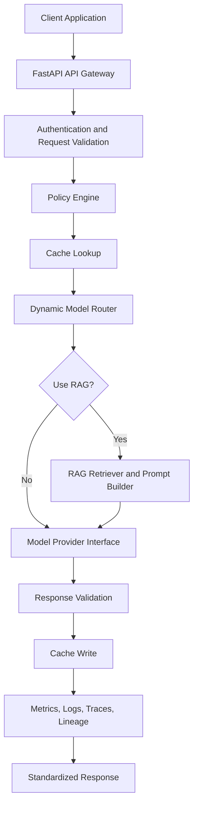
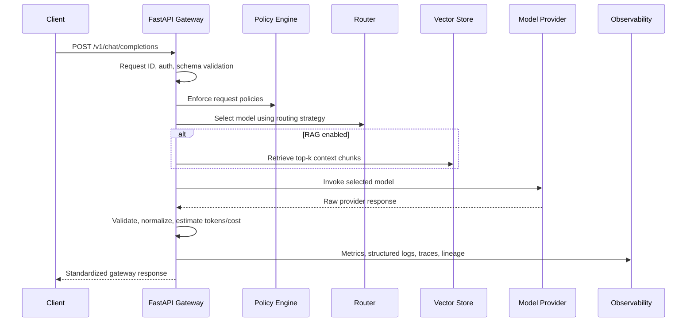

# Architecture

## Objective

I implemented a centralized LLM Gateway that gives applications one stable API for multiple model providers, retrieval pipelines, policy checks, caching, observability, and governance controls.

The local version is intentionally runnable on a normal development laptop. Production-oriented extension points are included for Redis, PostgreSQL, Kubernetes, AWS, OpenTelemetry, and external model providers.

## High-Level Components



## Request Flow



## Repository Structure

```text
llm-gateway-platform/
├── app/
│   ├── api/
│   │   ├── routes/
│   │   ├── dependencies.py
│   │   └── middleware/
│   ├── cache/
│   ├── core/
│   ├── db/
│   ├── gateway/
│   ├── governance/
│   ├── inference/
│   ├── observability/
│   ├── providers/
│   ├── rag/
│   ├── schemas/
│   └── main.py
├── configs/
├── tests/
│   ├── unit/
│   └── integration/
├── scripts/
├── sample_data/
├── benchmarks/
├── monitoring/
├── infra/
│   ├── kubernetes/
│   ├── helm/
│   └── terraform/
├── docs/
├── .github/workflows/
├── .env.example
├── Dockerfile
├── docker-compose.yml
├── Makefile
├── pyproject.toml
├── requirements.txt
└── README.md
```

## Implementation Phases

1. Project foundation, FastAPI, configuration, schemas, health endpoints.
2. Model provider abstraction and Hugging Face inference.
3. Model registry.
4. Dynamic routing engine.
5. Caching and token accounting.
6. Reliability, retry, fallback, circuit breaker.
7. RAG.
8. Observability.
9. Security and rate limiting.
10. Database, versioning, lineage, governance.
11. Docker and Docker Compose.
12. Kubernetes and Helm.
13. AWS and Terraform architecture.
14. Testing and load testing.
15. GitHub Actions.
16. Documentation, README, diagrams, and university presentation guide.

## Initial Python Dependencies

- `fastapi` and `uvicorn` for the HTTP gateway.
- `pydantic` and `pydantic-settings` for request contracts and configuration.
- `PyYAML` for model, routing, and policy configuration.
- `structlog` for JSON logging.
- `prometheus-client` for metrics.
- `pytest`, `httpx`, and `ruff` for tests and quality checks.

Later phases add `torch`, `transformers`, `sentence-transformers`, `redis`, `SQLAlchemy`, `Alembic`, `psutil`, vector store dependencies, OpenTelemetry packages, and Locust.

## Local Models

The local development profile starts with lightweight Hugging Face models:

- `distilgpt2`: small causal text-generation model for local generation paths.
- `google/flan-t5-small`: instruction-following text2text model that can support RAG prompts better than a plain causal model.
- `sentence-transformers/all-MiniLM-L6-v2`: compact embedding model for semantic search and RAG.

These are intentionally CPU-friendly compared with larger foundation models. GPU support will be automatic when available, but not required.

## Real vs Abstracted in Local Development

Real local implementation:

- FastAPI API contracts.
- API-key authentication.
- YAML model metadata.
- Dynamic routing logic.
- Hugging Face local model execution.
- Redis-backed caching with in-memory fallback.
- Local vector search for RAG.
- Prometheus metrics.
- Structured logging.
- Docker Compose.
- Tests.

Production-style abstraction or documented extension:

- External hosted model providers.
- Multi-node distributed inference.
- GPU node pool orchestration.
- Enterprise-grade policy workflows.
- Full AWS environment provisioning.
- Human review systems.
- Advanced queueing and batch schedulers.

The project should not claim production benchmark results until load tests are run and saved under `benchmarks/`.

## Laptop Resource Constraints

Local inference can be slow on CPU and may require several gigabytes of disk space for model downloads. The default model set avoids GPU-only dependencies, but first-run Hugging Face downloads can still take time. Larger models, high concurrency, and high `max_tokens` settings should be treated as production or GPU-node scenarios.
