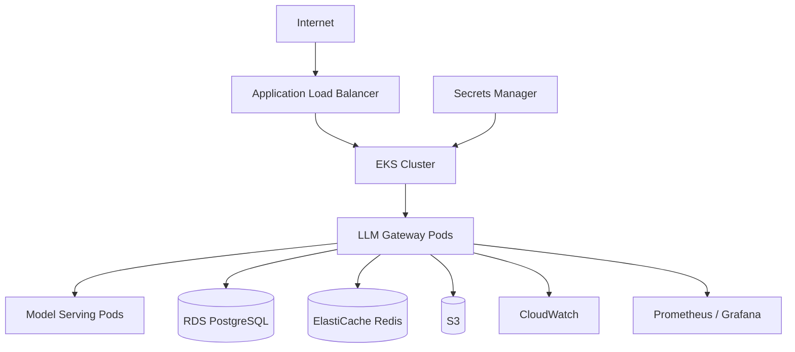

# AWS Architecture

The intended AWS deployment uses:

- EKS for container orchestration.
- ECR for gateway and model-serving images.
- Application Load Balancer for ingress.
- RDS PostgreSQL for metadata.
- ElastiCache Redis for cache and rate limiting.
- S3 for model artifacts, ingestion data, and benchmark artifacts.
- Secrets Manager for API keys and database credentials.
- CloudWatch for logs and platform metrics.
- Prometheus and Grafana for service-level metrics.
- Optional GPU EC2 node group for larger model serving.

Local development does not require AWS resources.

