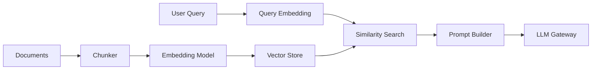

# RAG

The RAG pipeline ingests documents, chunks text, generates embeddings, stores vectors locally, retrieves top-k matching chunks, builds an augmented prompt, and routes generation through the same gateway execution path.

The local implementation uses an in-memory vector store and deterministic local embeddings by default so tests and demos run without downloads. The configured embedding model is `sentence-transformers/all-MiniLM-L6-v2`, which can be used through the optional Hugging Face provider path.
